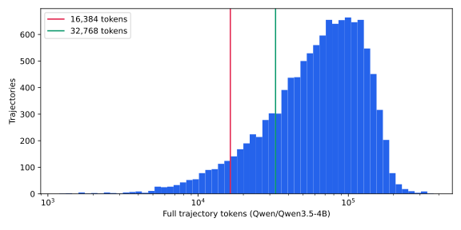

# OpenSeeker 数据研究与实测结果

## 研究范围和证据

论文 [OpenSeeker: Democratizing Frontier Search Agents by Fully Open-Sourcing Training Data](https://arxiv.org/html/2603.15594v1) 描述两步：从网页关系构造多跳问题；使用回顾性摘要帮助教师产生推理与动作，但让学生在原始工具观察上训练。论文的摘要机制与本项目的学习式 Beacon KV 压缩不是同一算法。本项目保持原始观察，只用原有 Beacon 在前向时压缩观察区域，不声称复现论文的 30B 模型结果。

核查来源：

- [PolarSeeker 官方数据文件](https://huggingface.co/datasets/PolarSeeker/OpenSeeker-v1-Data/tree/main)。本地恢复了 commit `5970e581dc1548f37d846a1955cb8b651d2b657e`，原文件 3,224,769,676 bytes，SHA256 `7cc9aaabdaea00a3d410952c1ad978191440871e2424c86498723f8dc1e5d3f7`。
- [Zephyr 数据主页](https://huggingface.co/datasets/Zephyr271828/openseeker_v1_sft) 与 [文件列表](https://huggingface.co/datasets/Zephyr271828/openseeker_v1_sft/tree/main)：可核实总行数 4,949、train/val 两 split、Parquet 格式和字段概况。**没有完成本地下载和逐条检查**，不能把下面的官方全量分布套用到 Zephyr。
- 原项目已有的 3,538,289,087 bytes JSONL 与官方快照逐行解析后完全相同（格式/转义造成字节数不同），共 11,677 条；见 [source_verification.json](openseeker/source_verification.json)。以下实测以该 JSONL 为输入。

没有用旧项目的 Qwen3-Instruct 或 Qwen3.5-2B 统计冒充本次模型的统计；Qwen3-Thinking tokenizer 本地缺失且终端无法解析 Hugging Face / 镜像域名，其精确 token 分布留待联网复测。

## 1. 两种数据结构

| 项目 | Polar 官方版本 | Zephyr SFT 版本 |
|---|---|---|
| 原始存储 | 单个 `openseeker_v1_data.jsonl` | `train.parquet` / `val.parquet` |
| 核心字段 | `question`, `answer`, `number of tool calls`, `trajectory`, `trajectory correctness` | `messages`, `tools`, `question`, `answer`, `n_tool_calls` |
| 工具定义 | system 内 `<tools>` JSON 定义 | 独立 `tools` 列，OpenAI function schema |
| 工具动作 | assistant 内容中的 JSON + XML 包装 | 适配结构化 `tool_calls`，同时接受正文中的调用协议 |
| 工具结果 | role=user，`<tool_response>` 包装 | 适配 role=tool + tool_call_id；保留原始输入 |
| 本次证据 | 全量实测 | 网站字段核实 + 合成结构测试，内部子字段须下载后核验 |

Zephyr 的总数恰好等于官方 `Correct` 的 4,949 条，且网页展示的首题一致，因此**推测**它是正确轨迹的重排/转换版本；这不是已完成的逐条集合等价证明。由于没有 dataset card 描述过滤规则，不能仅凭行数认定两者可作为独立训练/测试来源。

## 2. 官方全量结构、语言和质量

来源：[结构报告](openseeker/polar_structure.json)、[质量与长度分层报告](openseeker/quality_length.json)。

| 指标 | 实测 |
|---|---:|
| 总轨迹 / 唯一规范化问题 | 11,677 / 11,677 |
| `Correct` | 4,949（42.38%） |
| `Incorrect` | 6,728（57.62%） |
| 问题包含 CJK 字符 | 1,429 |
| 问题不包含 CJK 字符 | 10,248 |
| system / user / assistant 消息 | 11,677 / 548,523 / 548,523 |
| 每轨迹消息数：中位 / P95 / 最大 | 75 / 241 / 403 |
| 规范化格式失败 | 0 |

语言统计只是“问题是否含 CJK 字符”的可重复启发式，不等于严格的语言分类。未出现重复问题不代表没有主题相似题，划分只控制规范化文本相同的题目泄漏。

**一个容易误用的字段：**所有 11,677 条的 `number of tool calls` 实际都等于 assistant 消息数，包含最终回答，因此不应直接当作真实函数调用数。只有 123 条碰巧和实际函数调用数相同；11,334 条等于实际调用数加一。少量批量函数调用使两种计数的差值不固定。脚本保留原字段，分析与执行一律解析实际 `<tool_call>`。

## 3. 工具组成与任务复杂度

全量解析得到 538,462 次函数调用：

| 工具 | 调用次数 | 参数 |
|---|---:|---|
| search | 425,318（78.99%） | `query`: 字符串数组；一次函数调用可包含多个搜索查询 |
| visit | 113,144（21.01%） | `url`: 单 URL 或数组；`goal`: 提取目标 |

实际调用次数每轨迹中位数 36，均值 46.11，P95 为 120，最大 200；不能沿用原 Search-R1 几次搜索的默认轮数。新的推理轮数默认 32 是受限实验预算，不能覆盖完整长尾。

全量中还出现参数异常：2 次 search 缺少 query；visit 参数包含少量 cursor/id/loc/num_lines，且部分缺少 url/goal。原始错误动作不能自动“修复”为搜索请求。适配器保留参数对象，语法非法时隔离；HTTP 工具服务负责具体工具 schema 的语义验证，执行失败单独记录。

`visit` 观察与 search 结果都属于可压缩外部信息，问题、系统工具定义、推理、工具名/参数和最终回答保持可见。未知工具通过通用 dispatcher 接口扩展，不把 visit 降级为一次 BM25 search。

## 4. Qwen3.5-4B 全量 token 分布

测量使用指定模型的本地 tokenizer，对**与实际训练相同的 ChatML 分段编码**计数，包含 system 工具定义、消息边界和全部轨迹。不是网页字符估算，也不是换成 Search-R1 提示词后的统计。tokenizer backend SHA256 记录在 [manifest](openseeker/polar_qwen35_tokens.json)。

| token 类别 | 均值 | 中位数 | P95 | 最大 |
|---|---:|---:|---:|---:|
| 完整序列 | 74,982 | 68,219 | 158,144 | 369,679 |
| 可压缩观察正文 | 51,524 | 45,286 | 114,864 | 335,930 |
| assistant 监督部分（含结束符） | 22,413 | 20,022 | 48,545 | 75,216 |

观察正文约占总 token 的 68.71%；剩余上下文仍然很长。即使压缩比为 16，也不能简单把完整计算成本或显存除以 16。特别是 6,967 条轨迹的 assistant 监督部分本身已超过 16k。

质量分层也显著不同：Correct 的平均长度约 51,816，而 Incorrect 为 92,023。盲目训练全部数据不仅监督大量错误答案，也使长度分布偏向长而失败的搜索过程。

## 5. 筛选收益与偏差

以下阈值均为完整、未截断序列长度；只应用质量与长度条件，问题去重没有额外减少本次数据。

| 上限 | 所有质量标签中符合长度的条数 | Correct 且符合长度 | 占全部 Correct |
|---|---:|---:|---:|
| 8,192 | 207 | 170 | 3.43% |
| 16,384 | 810 | 664 | 13.42% |
| 32,768 | 2,349 | 1,759 | 35.54% |
| 65,536 | 5,609 | 3,508 | 70.88% |

已实际生成：

- `polar_correct_qwen35_16k`：644 train / 9 validation / 11 test，正确子集中 CJK 问题 69 条；工具调用总数 search=1,535、visit=893。
- `polar_correct_qwen35_32k`：1,696 train / 23 validation / 40 test，CJK 问题 201 条；工具调用总数 search=9,736、visit=4,576。

16k 正确子集平均只有约 3.66 次函数调用（2,428 / 664），而全量均值 46.11；因此这是资源受限的短轨迹实验集，**不是完整 OpenSeeker 能力的无偏代表**。visit 占比和任务难度也随筛选改变。test 仅 11 或 40 条，分数波动很大，不能作为论文 benchmark 结果。

推荐先用 16k 验证训练稳定性和 plain/beacon 对照，再在 80GB 卡上实测 32k 的峰值显存。如果扩大到 64k，应单独建立实验，不把原始长轨迹切断后混入短轨迹组。论文任务的正式评测还需独立 benchmark 数据、真实 search/visit 工具及相应评分协议，本仓库的 held-out EM / replay 诊断不等价于它们。

## 6. 尚未实测的部分

Zephyr 全量 Parquet 下载与 token 分布、两个发布版本的逐题集合比对、Qwen3-Thinking 精确长度、80GB GPU 的训练显存/吞吐、真实联网工具 rollout 都尚未运行。相关可重跑入口已保留；当前完成的是官方数据的全量离线分析/筛选、两种输入格式的适配和 CPU 功能验证。

补充参数核验：16k 正确子集中没有 search 缺 query / visit 缺 url 或 goal 的调用；32k 正确子集中仍有 2 次 visit 缺少必需参数。Correct 只反映最终答案标注，不能保证每个中间动作都符合 schema；原轨迹保留这些行为，工具执行端会记录失败。若研究要求“每一步动作均合法”，应在正确性之外增加具体工具 schema 的过滤规则，并重新记录子集规模。
